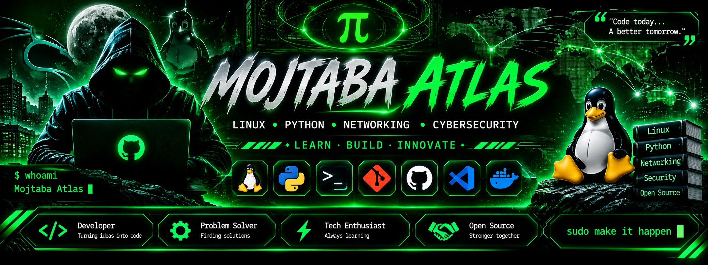

<div align="center">



### `LINUX • PYTHON • NETWORKING • CYBERSECURITY`

[](https://www.linux.org/)
[](https://www.python.org/)
[](https://github.com/mojtabaatlas313-cmd)

**LEARN • BUILD • AUTOMATE • INNOVATE**

</div>

---

## `01` — WHO AM I?

```bash
┌──(mojtaba㉿atlas)-[~]
└─$ whoami
Mojtaba Atlas
```

I'm **Mojtaba Atlas**, a Linux and Python enthusiast interested in system administration, automation, computer networking, and cybersecurity.

I enjoy exploring technology, learning new tools, solving problems, and building practical projects.

---

## `02` — TECH STACK

<div align="center">

**Operating Systems & Scripting**

[](https://skillicons.dev)

**Development & Tools**

[](https://skillicons.dev)

</div>

---

## `03` — CORE EXPERTISE

| Field | Interests |
|:--|:--|
| 🐧 Linux | System Administration |
| 🐍 Python | Development & Automation |
| 🌐 Networking | Protocols & Network Systems |
| 🔐 Cybersecurity | Security Fundamentals |
| ⚙️ Open Source | Tools & Collaboration |

---

## `04` — DEVELOPER MINDSET

```python
class MojtabaAtlas:
    name = "Mojtaba Atlas"
    focus = ["Linux", "Python"]
    interests = [
        "Networking",
        "Cybersecurity",
        "Open Source"
    ]

    def mission(self):
        return "Learn. Build. Innovate."


me = MojtabaAtlas()
print(me.mission())
```

---

## `05` — GITHUB STATISTICS

<div align="center">


<br/>


</div>

---

## `06` — CONTRIBUTION ACTIVITY

<div align="center">


</div>

---

## `07` — CURRENT FOCUS

- Improving Linux administration skills
- Building practical Python tools
- Learning computer networking
- Exploring cybersecurity fundamentals
- Contributing to open-source projects

---

## `08` — EXPLORE MY GITHUB

<div align="center">

[](https://github.com/mojtabaatlas313-cmd?tab=repositories)

[](https://github.com/mojtabaatlas313-cmd)

</div>

---

## `09` — CONNECT WITH ME

<div align="center">

[](https://github.com/mojtabaatlas313-cmd)

<br/>

```bash
sudo make it happen
```

### `MOJTABA ATLAS`

**KEEP BUILDING.**

<sub>Powered by curiosity, persistence and code.</sub>

</div>
